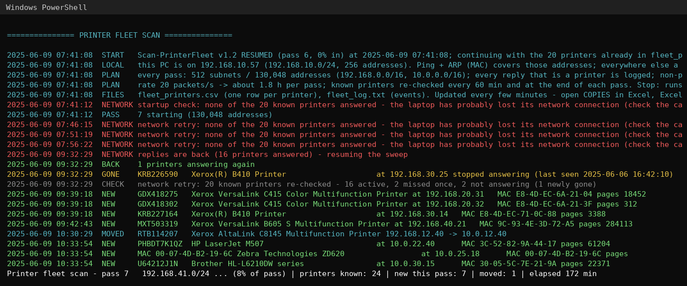

# Printer Fleet Scanner

A single PowerShell script that sweeps an entire corporate network with read-only SNMP, around the clock, and keeps a live inventory of every printer that answers: serial, model, MAC, IP, and page count. Built for managed-print technicians who need to find "missing" printers and their meter reads. Nothing to install, no admin rights, no modules.




*Sample output with fictional devices (`samples/fleet_log.txt`).*

## Why I built it

From 2024 to 2026 I worked at Acordis as a printer technician assigned to a large children's hospital in Miami, with roughly 1,100 networked printers. Every month we had to collect a meter read (page count) from every printer for billing. The fleet-management software was supposed to find each printer and pull the meter automatically, but it keyed on the printer's IP and hostname. When a printer got swapped, moved to another floor, or landed on a new VLAN, its IP changed, the software lost it, and the printer showed up on the monthly "missing meters" list. Then someone had to go find it by hand.

I built this tool to do that search for me. It tries every IP address on the network, one by one, and logs every printer that answers with its serial number, MAC address, model, current IP and page count. Because it keys on the serial instead of the IP, it recognizes a printer that has moved and records the new address. That gave me the new IPs to update in the reporting software and the meters I needed for the monthly report, without walking the building.

In its first month in production it located 41 of the 124 printers on the missing list, including an entire building wing that had moved subnets and three printers still recorded as "in the warehouse" that were installed and printing.

## What it does

- **Whole-network sweep.** One read-only SNMP GET to every address in `-Ranges` (default: all of `10.0.0.0/8`, 16.6 million addresses), pass after pass, until you press **Q**.
- **Printers only.** A device is logged if it returns a Printer-MIB serial, a page count, or a model string with a printer-vendor word. Switches, UPSes and access points are ignored.
- **Per printer:** serial (Printer-MIB, HP private OID as fallback), model, MAC, total page count, device name.
- **SNMP v2c with v1 fallback**, community set with `-Community`.
- **Master list** `fleet_printers.csv`, one row per printer keyed by serial (or MAC, or IP): status, pages, first/last seen, times seen, previous IPs, subnet.
- **Event log** `fleet_log.txt`: `NEW`, `MOVED`, `GONE`, `BACK`, `CHECK`, `PASS`, `NETWORK`, `STOP`.
- **Move tracking.** The same serial at a new IP is logged as `MOVED`; the old address is kept in `PreviousIPs`.
- **Re-checks** every 60 minutes and at the end of each pass. A printer is `MISSED 1 CHECK` after one miss and `NOT ANSWERING since <last seen>` after two in a row; it's logged `BACK` when it answers again.
- **Outage detection.** If 20+ printers are known and none answers, it assumes the laptop lost the network, logs `NETWORK`, pauses, keeps every status unchanged, and retries every 5 minutes until replies come back.
- **Rate limited** with `-PacketsPerSecond` (default 800, about 7.6 h per pass over a /8).
- **Crash-safe.** Saves every 3 minutes and resumes from the same pass and position on restart.
- **Local subnet extras.** On the PC's own /24 and any `-Subnets`, it also pings and reads the ARP table, so a printer with SNMP disabled is still logged by MAC.
- **Stays awake** while running (`SetThreadExecutionState`), with a progress bar showing the current /24, percent of pass, printers known, and new/moved counts.

## Requirements

- Windows with **Windows PowerShell 5.1** (ships with Windows 10/11). PowerShell 7 is untested.
- Network reach to the targets on **UDP 161** (SNMP) and ICMP.
- An SNMP **read** community for the printers (default `public`).
- Authorization to scan the network. See [Responsible use](#responsible-use).

No modules, no installers, no admin rights.

## Quick start

```powershell
git clone https://github.com/LichaWeComeThere/printer-fleet-scanner.git
cd printer-fleet-scanner

# One pass over a small lab/home network, then stop
powershell -ExecutionPolicy Bypass -File .\Scan-PrinterFleet.ps1 -Ranges 192.168.1.0/24 -Passes 1

# Full run: every address in 10.0.0.0/8, repeating until you press Q
powershell -ExecutionPolicy Bypass -File .\Scan-PrinterFleet.ps1
```

Press **Q** to stop cleanly. Run the same command again to continue where it left off.

Within three minutes `fleet_printers.csv`, `fleet_log.txt` and `fleet_state.txt` appear next to the script. Open **copies** in Excel; Excel locks the file and the scanner will skip a save while it's open.

## Options

| Parameter | Default | What it does |
| --- | --- | --- |
| `-Ranges` | `10.0.0.0/8` | CIDR ranges to sweep each pass (comma-separated) |
| `-Exclude` | none | CIDR ranges to skip |
| `-Subnets` | none | Extra /24s to ping + ARP every pass (for MAC identification; plug into that VLAN) |
| `-Community` | `public` | SNMP read community |
| `-PacketsPerSecond` | `800` | Send rate. 1500 ≈ 4 h per /8 pass, 400 ≈ 15 h |
| `-RecheckMinutes` | `60` | How often known printers are re-probed; `0` = only at end of pass |
| `-NetworkRetrySeconds` | `300` | Retry interval while the network is down |
| `-Hours` / `-Passes` | `0` | Stop by itself after this many hours / complete passes (`0` = run until Q) |
| `-SeedFile` | none | CSV from an earlier scan to start from |
| `-BatchSubnets` | `16` | /24s probed per batch |
| `-SnmpPort` / `-TimeoutMs` / `-PingTimeoutMs` | `161` / `1500` / `1000` | Transport tuning |

Examples:

```powershell
.\Scan-PrinterFleet.ps1 -Ranges 10.1.0.0/16,10.2.0.0/16 -Passes 1
.\Scan-PrinterFleet.ps1 -Exclude 10.2.0.0/16 -Hours 24
.\Scan-PrinterFleet.ps1 -PacketsPerSecond 1500 -RecheckMinutes 30
.\Scan-PrinterFleet.ps1 -Ranges 192.168.0.0/16 -Subnets 192.168.1.0 -Community myreadonly
```

## Output files

| File | Contents |
| --- | --- |
| `fleet_printers.csv` | Master list. Columns: `Serial, Model, MAC, IP, Status, TotalPages, PagesReadAt, FirstSeen, LastSeen, TimesSeen, MissCount, PreviousIPs, DeviceName, Subnet, IdentifiedBy, Key` |
| `fleet_log.txt` | Timestamped events: `START LOCAL PLAN FILES NEW MOVED GONE BACK CHECK PASS NETWORK STOP` |
| `fleet_state.txt` | Pass number, cursor and ranges, so a restart resumes mid-pass |
| `fleet_seed.csv` | Optional starting list, read only when `fleet_printers.csv` doesn't exist yet |

`Status` is one of `ACTIVE`, `MISSED 1 CHECK`, or `NOT ANSWERING since <timestamp>`. Fictional examples of both files are in [`samples/`](samples).

## How it works

The script expands the requested CIDR ranges into /24 subnets and walks them 16 at a time. For every address it sends one SNMP GET asking for all seven OIDs at once (sysDescr, sysName, hrDeviceDescr, prtGeneralSerialNumber, prtMarkerLifeCount, ifPhysAddress.1/.2, plus the HP private serial). A stopwatch-based pacer holds the send rate at `-PacketsPerSecond` so a 16-million-address sweep stays gentle on a production network; replies are collected on a single UDP socket.

Printers are stored in a hashtable keyed by serial (falling back to MAC, then IP), so a device that changes IP is recognized as the same printer. State is written every three minutes: the CSV goes to a `.tmp` file and is renamed into place, and a small state file records pass and cursor.

### Hand-rolled SNMP client

There is no SNMP module on a locked-down work laptop, so the script implements its own SNMP v1/v2c GET client on top of `System.Net.Sockets.UdpClient`, including BER encoding and decoding of integers, OIDs, octet strings and the GetRequest/GetResponse PDUs. The whole thing runs with no installs, no admin rights and no internet access.

### Matching replies when PowerShell reports 0.0.0.0

On Windows PowerShell 5.1, `UdpClient.Receive` with a `[ref]` endpoint reported every reply as coming from `0.0.0.0`, which made it impossible to tell which address had answered. The fix: the target IP is stamped into the 4-byte SNMP request-id before each packet is sent. Agents echo the request-id back, so every reply identifies its own source regardless of what the socket reports.

### Telling "printers gone" from "laptop offline"

An early version marked about a thousand printers `GONE` when the laptop's Wi-Fi dropped. Now, if at least 20 printers are known and not one of them answers a re-check, the script treats it as a network outage: it logs `NETWORK`, leaves every status untouched, pauses the sweep, and retries every `-NetworkRetrySeconds` until replies return. When they do, printers that come back are summarized in one line instead of hundreds.

## Results in production

Ran almost continuously for five weeks on the hospital's ~1,100-printer network: 62 full passes, 1,138 printer records (895 office printers, 243 Zebra label printers). Spot-checked against the fleet-management console and against 33 meters read by hand: 16 matched exactly, 4 were higher by hand because the printers had printed in between, and the rest differed by a handful of pages because some HP models expose a different counter over SNMP than on their usage page.

## Known limitations

- A partial or garbled SNMP reply can create a duplicate row with a junk serial. Reports filter these with `^[A-Z0-9]{6,12}$`; a fix in the script is on the roadmap.
- Only the total page count is read; no mono/color split.
- MAC/ARP identification only works on the PC's own /24 or on `-Subnets`.
- If the network drops mid-sweep, up to one re-check interval of subnets is probed against a dead network before the outage is detected. They're simply covered on the next pass.
- Wired is strongly recommended; Wi-Fi drops trigger the outage pause. Closing the lid still sleeps the laptop.
- Printer detection is heuristic; an occasional non-printer can slip through.
- The progress bar garbles in a narrow console window.
- Tested only on Windows PowerShell 5.1.

## Roadmap

- Drop ghost rows from garbled replies inside the script
- Mono/color meter OIDs
- Optional automatic Wi-Fi reconnect during an outage
- A report script that matches a missing-meter list against `fleet_printers.csv`

## Responsible use

This tool sends SNMP and ICMP packets to every address in the ranges you give it. Run it only on networks you own or are explicitly authorized to scan, and tell your network team before the first full pass. It performs read-only queries and changes nothing on any device, but a 16-million-address sweep is visible to intrusion-detection systems and will look like a scan, because it is one.

## Credits

Built by **Manuel Diaz** while supporting a managed-print fleet: problem definition, requirements, five weeks of production runs, on-site verification against the printers and the management console, and the field bug reports (the `0.0.0.0` reply source, stale state files, Wi-Fi drops marking the whole fleet gone) that shaped v1.1.

The PowerShell code was written with Claude (Anthropic) as the coding tool, iterating from those requirements and bug reports. The SNMP implementation follows the public SNMP v1/v2c, Printer-MIB, Host Resources MIB and IF-MIB specifications; no third-party code is included.

Customer-identifying details (network ranges, device data, names) have been removed for publication. The data files in `samples/` are fictional.

## License

[MIT](LICENSE) © 2026 Manuel Diaz
